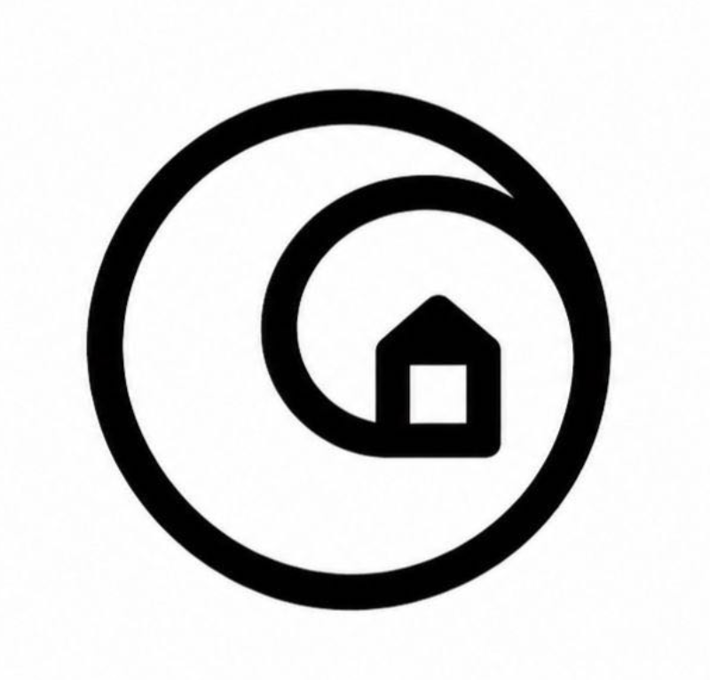
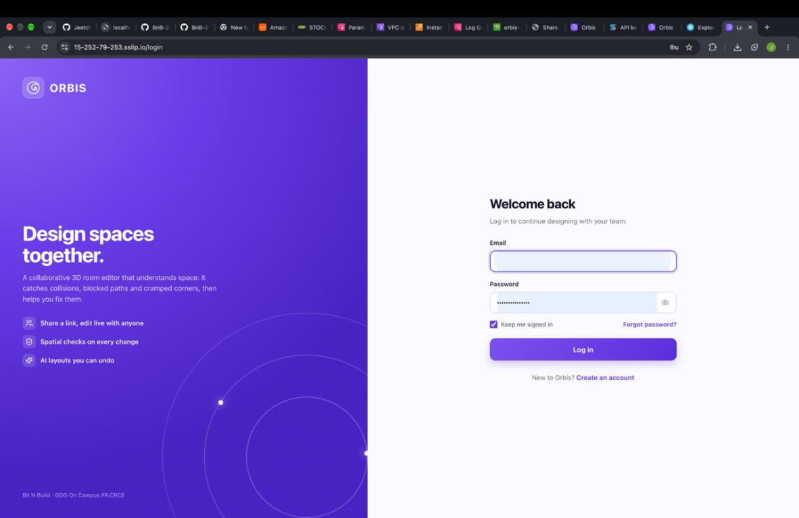
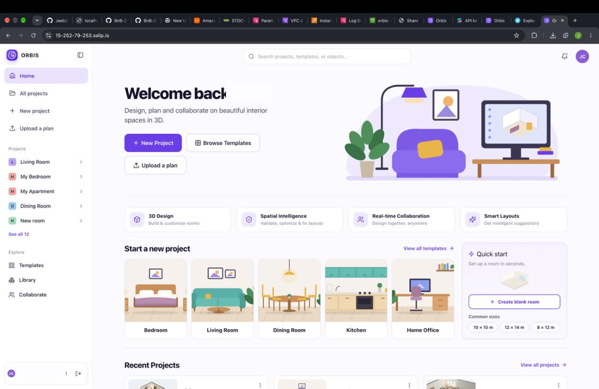
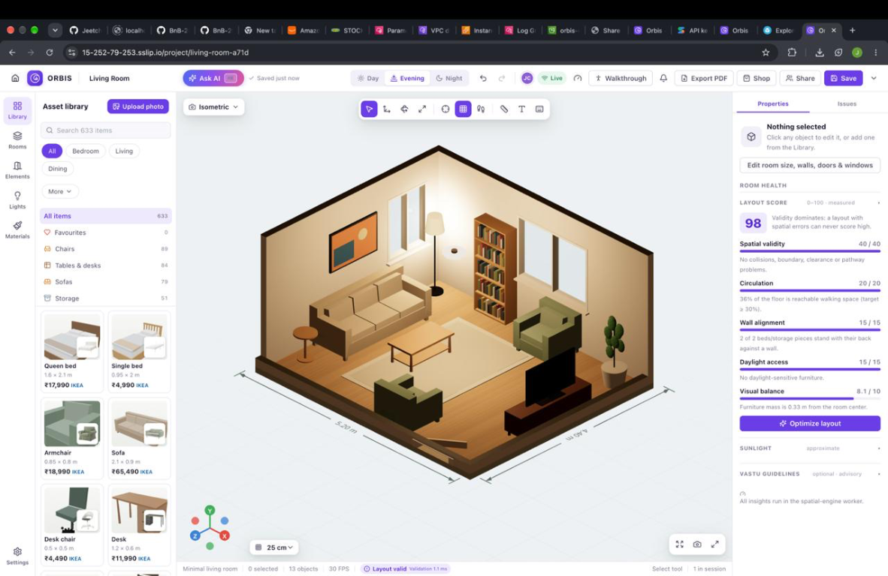
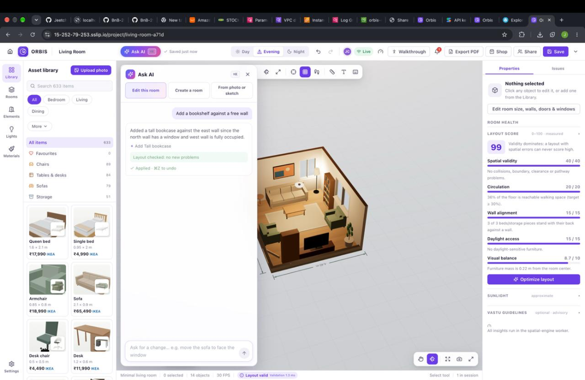
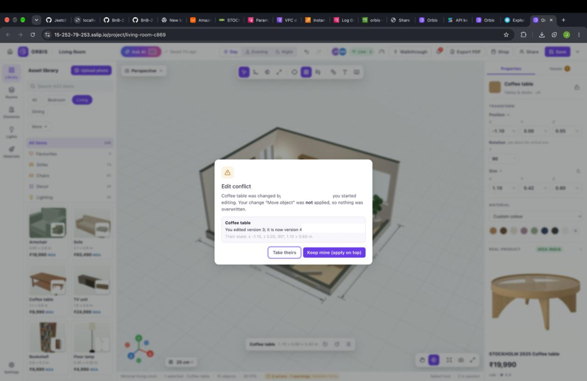
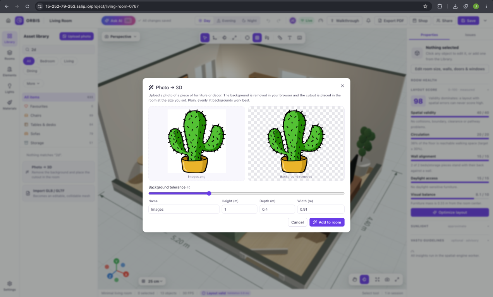
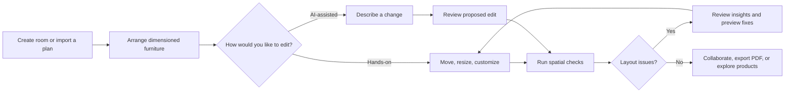
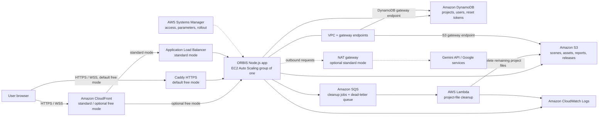
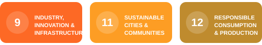

<div align="center">
  
  <h1>ORBIS</h1>
  <h3>Design spaces. Reimagine living.</h3>
  <p><strong>A collaborative 3D room designer with AI assistance and spatial intelligence.</strong></p>
  <p>Imagine a room, explore it in 3D, test furniture layouts, and make design decisions with more confidence.</p>

  <a href="https://react.dev/"></a>
  <a href="https://www.typescriptlang.org/"></a>
  <a href="https://vite.dev/"></a>
  <a href="https://threejs.org/"></a>
  <a href="https://r3f.docs.pmnd.rs/"></a>
  <a href="https://zustand.docs.pmnd.rs/"></a>
  <a href="https://nodejs.org/"></a>
  <a href="https://expressjs.com/"></a>
  <a href="https://developer.mozilla.org/en-US/docs/Web/API/WebSockets_API"></a>
  <a href="https://ai.google.dev/gemini-api"></a>
  <a href="https://zod.dev/"></a>
  <a href="https://aws.amazon.com/"></a>
  <a href="https://aws.amazon.com/ec2/"></a>
  <a href="https://aws.amazon.com/s3/"></a>
  <a href="https://aws.amazon.com/dynamodb/"></a>
  <a href="https://aws.amazon.com/sqs/"></a>
  <a href="https://aws.amazon.com/lambda/"></a>
  <a href="https://aws.amazon.com/cloudfront/"></a>
  <a href="https://aws.amazon.com/cloudwatch/"></a>
</div>

<br>

<div align="center">
  <a href="https://drive.google.com/drive/folders/11HNgpJi6MGsNuPPiQZZJRIUH6xb8klVq?usp=sharing"></a>
  &nbsp;&nbsp;
  <a href="https://drive.google.com/drive/folders/1h17VUPl_po72bVnNELa7pS_i0vmEbAxX?usp=sharing"></a>
</div>

<br>

<div align="center">
  <sub>Built by <strong>Mac And Code</strong> · Bit N Build 2026 · GDG On Campus FR.CRCE</sub>
</div>

## Contents

- [About ORBIS](#about-orbis)
- [The challenge](#the-challenge)
- [Application preview](#application-preview)
- [What you can do](#what-you-can-do)
- [Design workflow](#design-workflow)
- [Technology](#technology)
- [AWS architecture](#aws-architecture)
- [Project structure](#project-structure)
- [Getting started](#getting-started)
- [Deployment](#deployment)
- [Impact and future potential](#impact-and-future-potential)
- [Roadmap](#roadmap)
- [Team Mac And Code](#team-mac-and-code)

## About ORBIS

Planning a room is easier when you can see your ideas, try different layouts, and check how furniture fits before moving anything. **ORBIS** is a browser-based interior design application that brings room modeling, AI-assisted edits, spatial analysis, collaboration, and product discovery into one workspace.

Design a room floor by floor, furnish it in an interactive 3D editor, and inspect it from perspective, isometric, floor-plan, or eye-level walkthrough views. ORBIS helps surface spatial problems such as collisions, blocked paths, and insufficient clearances. When you want a second opinion, request an AI-assisted change and review the proposal before it becomes an undoable, shareable scene edit.

ORBIS is designed for people exploring a room before they rearrange it: homeowners, renters, design students, and interior-design collaborators. It aims to make spatial planning more approachable; it is not a substitute for professional architectural plans or construction advice.

## The challenge

| Room-planning challenge | ORBIS approach |
| --- | --- |
| It is difficult to picture a layout before changing a room. | Explore a furnished room in 3D, floor-plan, and walkthrough views. |
| Furniture may not fit as expected. | Edit dimension-aware objects and validate room boundaries, collisions, and clearances. |
| A room can look good but be hard to move through. | Check door swings, access zones, walkable paths, and routes from entrances. |
| Iterating on a layout can take time. | Review layout insights and preview validated recovery suggestions before applying them. |
| Remote collaborators need to stay in sync. | Share projects live, see presence, and resolve stale edits without silent overwrites. |
| Shopping and planning often happen separately. | Build a retailer-grouped room list from linked products and continue to retailer sites. |

## Application preview

These are screenshots of the supplied ORBIS app. Personal email and name text visible in the original sign-in, dashboard, and collaboration screenshots has been redacted.

<table>
  <tr>
    <td width="50%" align="center">
      
      <br><strong>Welcome to ORBIS</strong><br><sub>A branded entry point for the room-design workspace.</sub>
    </td>
    <td width="50%" align="center">
      
      <br><strong>Project dashboard</strong><br><sub>Pick up a recent project, start from a template, or create a room.</sub>
    </td>
  </tr>
  <tr>
    <td width="50%" align="center">
      
      <br><strong>3D room designer</strong><br><sub>Arrange furniture and inspect spatial health alongside the room.</sub>
    </td>
    <td width="50%" align="center">
      
      <br><strong>AI design assistant</strong><br><sub>Review a proposed room edit and its layout check.</sub>
    </td>
  </tr>
  <tr>
    <td width="50%" align="center">
      
      <br><strong>Conflict-safe collaboration</strong><br><sub>Choose whether to keep an edit or accept the collaborator's newer change.</sub>
    </td>
    <td width="50%" align="center">
      
      <br><strong>Photo to 3D</strong><br><sub>Prepare a cutout and set its dimensions before placing it in a room.</sub>
    </td>
  </tr>
</table>

## What you can do

### 🏠 Design and customize rooms

- Build multi-floor scenes with adjustable room dimensions, walls, doors, windows, and surface finishes.
- Place, move, rotate, resize, duplicate, recolour, and remove furniture using direct manipulation, snapping, gizmos, and the inspector.
- Browse room templates and a categorized asset library; import GLB/GLTF objects and edit supported meshes.
- Switch between perspective, isometric, orthographic, floor-plan, and first-person walkthrough views.
- Preview day, evening, and night lighting, including editable light fixtures.

### 🤖 Ask AI for a hand

- Describe a design change in natural language, such as adding furniture or adjusting an object's placement.
- Review the proposed change; ORBIS converts it to a normal scene action and checks it with the spatial engine before applying.
- Create an approximate editable room from a photo, sketch, or floor plan. Measured dimensions and inferred furniture may need correction.
- Use optional Gemini-backed features by providing a server-side `GEMINI_API_KEY`. AI is not required for the rest of the editor.

### 🧠 Check the space, not just the image

- Detect furniture collisions, room-boundary issues, clearance constraints, blocked door swings, and inaccessible furniture.
- Analyze routes from room entrances with a walkability grid and A* pathfinding.
- See a layout score with explained components, then explore an optimizer's possible improvements.
- Preview layout-recovery candidates that are checked again before they are offered.
- Explore approximate sunlight analysis and a floor heat map. Vastu guidance is optional and advisory.

### 👥 Work together

- Share a project link; guests can join a shared room without creating an account.
- Synchronize edits over WebSockets and show collaborator presence and selections.
- Guard edits with object versions. If another person changes an object first, ORBIS surfaces a conflict instead of silently overwriting their work.
- Reconnect after interruptions and explicitly reconcile offline edits.
- Let project owners choose whether link visitors can edit or view.

### 🛍️ Explore furniture and share a design

- Use dimension-aware 3D furniture and inspect product references where available.
- Build a room-based shopping list grouped by retailer; sample prices are estimates, not live offers.
- Follow product or search links to supported retailers. ORBIS does not process payments or provide a unified checkout.
- Export a multi-view landscape PDF with room views and a furniture schedule; share a project or report link where supported.

## Design workflow

From the first room sketch to a shareable plan, the editor combines hands-on design with optional AI and spatial checks.



## Technology

<div align="center">
  <a href="https://react.dev/"></a>
  <a href="https://www.typescriptlang.org/"></a>
  <a href="https://threejs.org/"></a>
  <a href="https://nodejs.org/"></a>
  <a href="https://expressjs.com/"></a>
  <a href="https://ai.google.dev/gemini-api"></a>
  <a href="https://aws.amazon.com/"></a>
</div>

| Layer | Key technologies | What they do |
| --- | --- | --- |
| Web application | React 19, TypeScript, Vite | Interface, client-side editing, and build tooling |
| 3D editor | Three.js, React Three Fiber, Drei | Room rendering, model loading, camera controls, and interactions |
| Client state | Zustand | Workspace and scene state |
| API and collaboration | Node.js 22, Express, `ws` | HTTP API, authentication, persistence access, and real-time sessions |
| Shared contracts | TypeScript, Zod | Validated scene schemas, typed actions, and protocol contracts |
| Spatial computation | RBush, SAT, A*, SunCalc | Collision checks, clearances, routes, recovery, scoring, and sunlight study |
| AI | Gemini API | Optional language-based editing and image/plan extraction |
| Reports | jsPDF | Browser-generated design reports |
| Cloud option | EC2, S3, DynamoDB, SQS, Lambda, CloudFront | Hosting, durable data, cleanup jobs, and edge delivery |

## AWS architecture

The AWS infrastructure is described in the CloudFormation template and AWS-backed persistence and cleanup have been tested with LocalStack. **A deployment to a real AWS account has not yet been verified.** In particular, real-account CloudFront WebSocket pass-through, SSM rollout, and CloudWatch log delivery still need validation.

The default deployment is free mode: one EC2 `t3.micro` instance in a public subnet, with Caddy HTTPS and an Auto Scaling group configured to replace a failed instance. CloudFront is optional in that mode. Standard mode uses CloudFront and an Application Load Balancer in front of one EC2 `t4g.small` in private subnets, with an optional NAT gateway. Durable content is stored in S3 and records in DynamoDB. The collaboration server is intentionally a single instance because live scene sessions are authoritative in its memory.



| Service | Role in the configured design |
| --- | --- |
| **EC2 + Auto Scaling** | Runs the bundled Node.js application and collaboration server. The group is configured for one instance and health-based replacement. |
| **S3** | Stores scene files, thumbnails, uploads, generated reports, and deployment bundles. The template configures encryption, versioning, and public-access blocking. |
| **DynamoDB** | Stores project metadata, user records, and password-reset tokens in three on-demand tables. |
| **SQS + Lambda** | Handles asynchronous cleanup of leftover project files after project deletion; a dead-letter queue is configured. |
| **CloudWatch Logs** | Receives application and worker logs through configured log groups. Actual delivery in AWS is not yet verified. |
| **CloudFront + ALB** | Provides edge delivery and TLS in the standard layout; the ALB is only used in standard mode. |
| **VPC + IAM + Systems Manager** | Provides network isolation, scoped instance/worker permissions, secret parameters, and management/deployment access. |

> **Deployment note:** Amazon ECS and ECR are not used. ORBIS runs on EC2. Standard mode includes a NAT option; without NAT, outbound Gemini, Google, and SSM access may be unavailable.

## Project structure

```text
.
├── README.md
├── package.json
├── docs/
│   └── screenshots/
│       ├── orbis-logo.png
│       ├── login-redacted.png
│       ├── dashboard.png
│       ├── room-editor.png
│       ├── ai-assistant.png
│       ├── collaboration-conflict.png
│       └── photo-to-3d.png
└── apps/
    ├── .env.example
    ├── .gitignore
    ├── CLAUDE.md
    ├── README.md
    ├── package.json
    ├── package-lock.json
    ├── railway.json
    ├── vitest.config.ts
    ├── docs/
    │   ├── architecture.md
    │   ├── aws-deployment.md
    │   ├── collaboration-demo.md
    │   └── ux-research-planner5d.md
    ├── fixtures/
    │   ├── README.md
    │   ├── apartment-scene.json
    │   ├── bedroom-scene.json
    │   ├── studio-scene.json
    │   ├── vastu-guidelines.json
    │   └── templates/
    │       ├── dining.json
    │       ├── kitchen.json
    │       ├── living.json
    │       └── office.json
    ├── infra/
    │   └── aws/
    │       └── orbis.yaml
    ├── packages/
    │   ├── shared/
    │   │   ├── package.json
    │   │   ├── tsconfig.json
    │   │   └── src/
    │   │       ├── actions.ts (+ tests)
    │   │       ├── ai.ts
    │   │       ├── commerce.ts (+ tests)
    │   │       ├── contracts.test.ts
    │   │       ├── guidelines.ts
    │   │       ├── index.ts
    │   │       ├── mesh.ts (+ tests)
    │   │       ├── protocol.ts
    │   │       ├── schemas.ts
    │   │       └── underlay.test.ts
    │   └── spatial-engine/
    │       ├── package.json
    │       ├── tsconfig.json
    │       └── src/
    │           ├── engine.test.ts
    │           ├── geometry.ts
    │           ├── guidelines.ts
    │           ├── index.ts
    │           ├── insights.test.ts
    │           ├── pathways.ts
    │           ├── recovery.ts
    │           ├── score.ts
    │           ├── sunlight.ts
    │           └── validate.ts
    ├── scripts/
    │   ├── collab-smoke.mjs
    │   ├── dev.mjs
    │   ├── share.mjs
    │   ├── start.mjs
    │   ├── tunnel.mjs
    │   ├── aws/
    │   │   ├── build-release.mjs
    │   │   ├── deploy.mjs
    │   │   ├── secret.mjs
    │   │   └── test-local.mjs
    │   └── products/
    │       └── fetch-ikea.mts
    ├── server/
    │   ├── package.json
    │   ├── tsconfig.json
    │   ├── scripts/
    │   │   ├── generate-apartment.mts
    │   │   ├── generate-templates.mts
    │   │   ├── migrate-to-aws.ts
    │   │   └── warm-bedroom.mts
    │   └── src/
    │       ├── ai.ts (+ tests)
    │       ├── auth.ts (+ tests)
    │       ├── index.ts
    │       ├── sessions.ts (+ tests)
    │       └── storage.ts
    └── web/
        ├── index.html
        ├── package.json
        ├── postcss.config.js
        ├── tailwind.config.js
        ├── tsconfig.json
        ├── vite.config.ts
        ├── public/
        │   ├── favicon.svg
        │   ├── orbis-logo.png
        │   └── models/
        │       ├── LICENSE.md
        │       └── 13 CC0 glTF model folders:
        │           ArmChair_01, ClassicNightstand_01, GothicBed_01,
        │           desk_lamp_arm_01, dining_chair_02, dining_table,
        │           drawer_cabinet, metal_office_desk,
        │           modern_coffee_table_01, modern_wooden_cabinet,
        │           painted_wooden_cabinet, sofa_02,
        │           wooden_bookshelf_worn
        └── src/
            ├── App.tsx
            ├── index.css
            ├── main.tsx
            ├── components/
            │   ├── FloorPlan.tsx
            │   ├── SceneViewport.tsx
            │   ├── ai/AskAi.tsx
            │   ├── auth/AuthScreen.tsx
            │   ├── brand/Logo.tsx
            │   ├── home/
            │   │   ├── Home.tsx
            │   │   ├── Illustrations.tsx
            │   │   └── UploadPlan.tsx
            │   ├── panels/
            │   │   ├── ExportPdfDialog.tsx
            │   │   ├── InsightsPanel.tsx
            │   │   ├── Inspector.tsx
            │   │   ├── IssuesPanel.tsx
            │   │   ├── LeftPanel.tsx
            │   │   ├── Library.tsx
            │   │   ├── Overlays.tsx
            │   │   ├── PhotoTo3D.tsx
            │   │   ├── RulesPanel.tsx
            │   │   ├── SettingsDialog.tsx
            │   │   ├── Shop.tsx
            │   │   ├── Shortcuts.tsx
            │   │   ├── TopBar.tsx
            │   │   ├── WhatsAppIcon.tsx
            │   │   └── fields.tsx
            │   └── viewport/
            │       ├── Annotations.tsx
            │       ├── CutoutModel.tsx
            │       ├── Environment.tsx
            │       ├── FurnitureModel.tsx
            │       ├── ImportedModel.tsx
            │       ├── Interaction.tsx
            │       ├── MeshEditor.tsx
            │       ├── Placement.tsx
            │       ├── RealisticModel.tsx
            │       ├── Room.tsx
            │       ├── Underlay.tsx
            │       └── ViewportChrome.tsx
            ├── data/
            │   ├── catalog.ts
            │   ├── model-manifest.json
            │   ├── products.ts
            │   ├── real-products.json
            │   └── scene.ts
            ├── lib/
            │   ├── assets.ts
            │   ├── auth.ts
            │   ├── collab.ts
            │   ├── cutout.ts
            │   ├── designPdf.ts
            │   ├── doors.ts
            │   ├── floors.ts
            │   ├── glb.ts
            │   ├── openings.ts
            │   ├── perf.ts
            │   ├── placement.ts
            │   ├── planGeometry.ts
            │   ├── project.ts
            │   ├── share.ts
            │   ├── stress.ts
            │   ├── thumbnails.tsx
            │   ├── tools.ts
            │   └── ui.ts
            ├── store/
            │   └── workspace.ts
            └── workers/
                └── spatial.worker.ts
```

The tree lists every application source, package, configuration, test, script, fixture, and documentation file. Binary and paired glTF model assets are grouped by model folder to keep the map readable.

## Getting started

### Requirements

- Node.js **22.12+**
- npm **10+**
- A modern browser with WebGL enabled

### Install and run

From the repository root:

```bash
cd apps
npm ci
cp .env.example .env
npm run dev
```

Open [http://127.0.0.1:5173](http://127.0.0.1:5173). The development script starts the web app and API/collaboration server. The API listens on port `3001` by default; local project data is kept in `apps/server/data`.

Gemini features are optional. Add your own `GEMINI_API_KEY` to `apps/.env` to enable them. Keep credentials private, server-side, and out of source control.

### Validate a local change

Run these commands from `apps/`:

```bash
npm test
npm run typecheck
npm run build
```

## Deployment

### AWS

AWS deployment requires AWS CLI v2 credentials with permissions for the resources in the CloudFormation template. From `apps/`:

```bash
npm run aws:deploy
```

The default is free mode in `ap-south-1`; standard mode can incur ongoing costs:

```bash
npm run aws:deploy -- --standard
```

Store secrets with the provided helper (for example, `npm run aws:secret -- GEMINI_API_KEY`), not in the repository. Review the [AWS deployment guide](./apps/docs/aws-deployment.md) for costs, modes, migration, and limitations. AWS infrastructure is LocalStack-tested, but confirm the deployment and service behavior in your own AWS account.

### Railway

The repository includes a Railway configuration. Set the service root to `apps`, configure a persistent volume mounted at `/data`, and set `RB_DATA_DIR=/data`. Add `GEMINI_API_KEY` only when enabling AI features.

## Impact and future potential

ORBIS helps people explore room dimensions, layout options, and furniture fit before making changes or following a product link.

<div align="center">
  
</div>

It connects to **SDG 9** through digital design tools, **SDG 11** through thoughtful space planning, and **SDG 12** by encouraging informed furniture decisions. These are potential contributions, not measured impact claims.

**Future opportunities** include verified retailer integrations, affiliate commerce, premium AI tools, designer/client collaboration, and expanded professional report workflows. These are potential directions, not current checkout or revenue features.

## Roadmap

### ✅ Implemented

- Multi-floor 3D room editing, furniture customization, and model import.
- Spatial validation, layout insights, sunlight analysis, and recovery suggestions.
- Gemini-assisted edits and approximate image/floor-plan reconstruction.
- Shareable rooms, WebSocket collaboration, conflict handling, and PDF export.
- Local storage and AWS storage/cleanup implementation tested with LocalStack.

### 🔍 Verification in progress

- Real-account AWS deployment and end-to-end verification of CloudFront, SSM rollouts, and CloudWatch log delivery.

### 💡 Future possibilities

- Direct retailer inventory and checkout integrations.
- Expanded professional collaboration and reporting.
- Production deployment evaluation and operational monitoring.

## Team Mac And Code

| Name | Role |
| --- | --- |
| **Meet Mangaonkar** | **Team Lead** |
| Jeet Chavan | Team Member |
| Sanika Lobo | Team Member |
| Yash Masaye | Team Member |

<br>

<div align="center">
  <strong>ORBIS · Design spaces. Reimagine living.</strong><br>
  <sub>Built with care by Team Mac And Code</sub><br><br>
  
</div>
